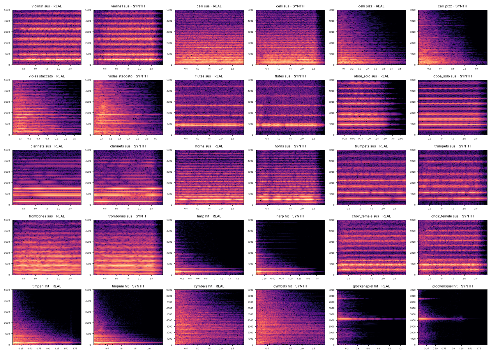

# orchestra-bgm

실제 오케스트라 녹음을 분석해 얻은 측정값만으로 악기와 섹션을 다시 합성하는 오케스트라 BGM 엔진이자 Claude 스킬입니다.
렌더링할 때 오디오 샘플은 쓰지 않습니다. 악보를 파이썬 코드로 쓰면 스테레오 WAV가 나옵니다.

*An orchestral BGM engine (and Claude skill) that re-synthesizes every instrument and section from parameters
measured on real recordings — no samples are played back at render time.*

## 무엇을 측정하고 재현하나

| 대상 | 분석 → 재현 |
|---|---|
| 톤 악기 | 음높이·셈여림별 배음 스펙트럼, 어택 중 배음 변화, 활·숨·몸통 노이즈(시간 격자별), 비브라토, 셈여림에 따른 음색 기울기, 릴리즈 |
| 섹션(합주) | 섹션 녹음의 배음선 퍼짐(cent) → 가상 연주자 N명의 음정 편차·비브라토·타이밍·음색 차이·좌석 위치. 합성→재분석 폐루프로 원본과 같은 퍼짐이 되도록 보정 |
| 짧은 음·피치카토 | 2 ms 즉시 어택, 정렬된 위상, 섹션 연주자 간 배음 간섭 보정 |
| 타악기 | 공명 모드(팀파니 70개, 심벌·탐탐 최대 1,500개)를 시간 추적. 강한 모드는 측정한 음량 곡선을 그대로 사용(머묾·맥놀이·다단 감쇠), 금속 악기 잔여분은 고정 무작위 공명선 |
| 무대 | 좌석 배치(팬·폭·깊이), 거리별 고역 감쇠·잔향 비율, 콘서트홀 IR, 마스터(`concert` / `shorts`: -14 LUFS·-1 dBTP·내레이션 자리 비우기) |

**검증**: 합성음을 원본과 같은 분석기로 다시 측정했을 때, 92개 음 기준 배음 스펙트럼 오차 중앙값 1.8 dB, 노이즈 성분 오차 대부분 1–2 dB,
타악기 시간-대역 엔벨로프 오차 3–4 dB. 비교 그림과 수치는 [`docs/`](docs)에 있습니다.



## 빠른 시작

```bash
pip install numpy scipy soundfile
```

```python
from orchestra import Score
s = Score(bpm=84, rt=2.3)
s.chord('violins2', 0, ['A4', 'D5'], 4, dyn='p', dyn_end='mf')
s.line('violins1', 0, 'A4:1 D5:1.5 E5:.5 F5:1 | G5:2 F5:1 E5:1', dyn='mp', legato=True)
s.note('celli', 0, 'D3', 8, dyn='p')
s.hit('timpani', 0, 'D2', dyn='f')
s.render('cue.wav')                         # master='shorts', narration=True 로 쇼츠용 마스터
```

악기 37종(현·목관·금관 섹션과 솔로, 하프, 합창, 타악기)을 쓸 수 있습니다.
파트 이름, 실용 음역, 주법, 편곡 규칙, 쇼츠용 조정 규칙은 [`SKILL.md`](SKILL.md)에 정리되어 있습니다.

## 구성

```
orchestra.py        합성 엔진 + Score API + 홀/마스터링
profiles.json       측정된 악기 프로파일 (오디오 없음)
SKILL.md            Claude 스킬 문서 (작곡·편곡·렌더 규칙)
examples/
  demo_theme.py     77초 시네마틱 큐
  demo_shorts.py    30초 쇼츠 큐 (첫 박 훅, -14 LUFS)
  ashen_throne.py   2분 다크 판타지(소울라이크) BGM: 종소리·남성 합창·오스티나토·투티 클라이맥스
  swan_lake.py      차이콥스키 백조의 호수 2막 No.10 1–9마디 (원 총보에서 옮김)
analysis/           프로파일 재생성 파이프라인
  fetch_samples.sh, sample_urls.txt   원본 샘플 받기
  analyze.py → build_profiles.py → validate.py calib / noisecal / perccal / report
  ab_compare.py, diag.py              원본↔합성 A/B 음원·진단 그림
docs/               검증 그림·보정값·검증 수치
```

## 프로파일 다시 만들기

`analysis/` 폴더에서 다음 순서로 실행합니다.

```bash
python3 analyze.py           # flac/ 폴더의 샘플 → analysis_raw.json
python3 build_profiles.py    # → ../profiles.json (보정값 초기화)
python3 validate.py calib    # 섹션 퍼짐 보정
python3 validate.py noisecal # 노이즈 성분 보정(음높이별)
python3 validate.py perccal  # 타악기 보정
python3 validate.py report   # 오차 확인
```

## 출처와 라이선스

`profiles.json`은 아래 샘플 라이브러리를 분석한 **측정값**(스펙트럼·엔벨로프·모드 파라미터)만 담고 있으며 오디오는 포함하지 않습니다.

- [VSCO-2 Community Edition](https://github.com/sgossner/VSCO-2-CE) — Versilian Studios, CC0
- [Sonatina Symphonic Orchestra](https://github.com/peastman/sso) — Mattias Westlund, Creative Commons Sampling Plus 1.0

`examples/swan_lake.py`의 악보는 퍼블릭 도메인인 차이콥스키 전집 11권(Muzgiz, 1957/1966)
[IMSLP #1056592](https://imslp.org/wiki/Swan_Lake_(ballet),_Op.20_(Tchaikovsky,_Pyotr_Ilyich))에서 옮겼습니다.
